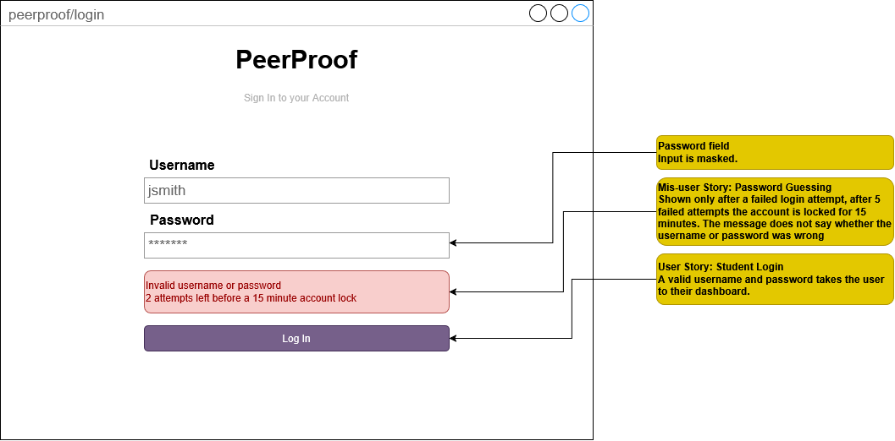
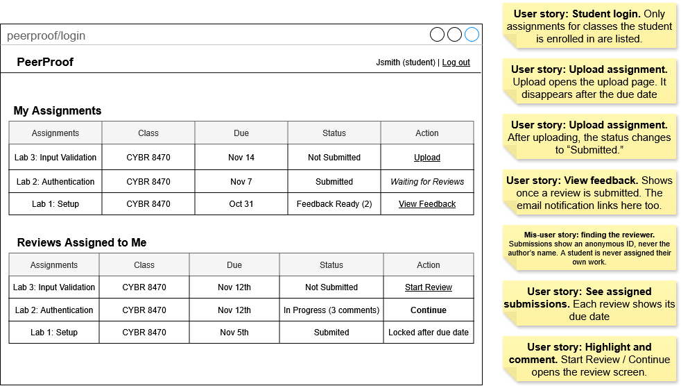

# User Stories

## Student

As a **Student**, I want to **log in to my account** so I can **see only the assignments and feedback that belong to me**.
  - A student who enters a valid username and password is taken to their dashboard.
  - The dashboard only lists assignments for classes the student is enrolled in.

As a **Student**, I want to **upload my assignment to the student portal** so I can **get feedback on my work from my peers**.
  - A student can upload a file to an open assignment before the due date.
  - After uploading, the assignment shows a status of "Submitted" on the student's dashboard.
  - Uploads after the due date are rejected with a message explaining why.

As a **Student**, I want **my submission to be protected before a reviewer sees it** so I can **trust that the feedback I get came from my peers and not an AI tool**.
  - Reviewers can only view the protected version of a submission, never the original file.
  - Text copied from the reviewer's view does not paste as the original readable text.

As a **Student**, I want to **view the highlights and comments on my work** so I can **understand what to improve**.
  - After a review is submitted, the student sees each highlighted section with its attached comment.
  - The student can reply to any comment.
  - The reviewer's name is not shown to the student.

As a **Student**, I want to **receive an email when feedback on my work is ready** so I can **respond without constantly checking the site**.
  - An email is sent to the student when a reviewer submits a review of their work.
  - The email includes the assignment name and a link to view the feedback.

## Reviewer

As a **Reviewer**, I want to **see the submissions assigned to me** so I can **complete my reviews before the due date**.
  - The reviewer's dashboard lists each assigned submission with its review due date.
  - The author's name is not shown on any assigned submission.
  - A reviewer is never assigned their own submission.

As a **Reviewer**, I want to **highlight a specific section of a submission and comment on it** so I can **point out exactly where an issue is**.
  - The reviewer can select a line or passage and attach a comment to it.
  - Highlights and comments are saved and remain after the page is reloaded.

As a **Reviewer**, I want to **reply to the author's responses** so I can **clarify my feedback**.
  - Replies appear in a thread under the original comment.
  - Both the author and the reviewer can see the full thread.

As a **Reviewer**, I want to **submit my completed review** so I can **receive credit for my work**.
  - A review cannot be submitted without at least one comment.
  - Once submitted, the review is visible to the instructor and the author.
  - The reviewer cannot edit the review after the review due date.

## Instructor

As an **Instructor**, I want to **create an assignment** so I can **give my students work to submit and review**.
  - The instructor can enter a title, instructions, submission type (code, written response, or other), a submission due date, and a review due date.
  - After saving, the assignment appears on the dashboard of every enrolled student.

As an **Instructor**, I want **reviewers to be assigned to submissions automatically** so I can **avoid matching students by hand**.
  - The instructor chooses how many reviewers each submission gets.
  - No student is assigned to review their own submission.
  - Reviews are spread evenly, so no student gets more than one review more than any other student.

As an **Instructor**, I want to **view all reviews for an assignment** so I can **grade reviewers on the quality of their feedback**.
  - The instructor sees each submission with all of its reviews and the reviewer names.
  - The instructor can enter a grade for each review.
    
# Mis-User Stories

As a **malicious outsider**, I want to **guess passwords on the login page** so I can **take over a student or instructor account**.
  - After 5 failed login attempts, the account is locked for 15 minutes.
  - Passwords are stored hashed and salted, never in plain text.

As a **retaliating student**, I want to **find out who reviewed my work** so I can **harass a reviewer who gave me harsh feedback**.
  - Reviewer names, usernames, and IDs are never included in any page or response sent to the author.
  - Only the instructor can see who reviewed each submission.

As a **lazy reviewer**, I want to **submit empty or copy-pasted reviews** so I can **get credit without doing the work**.
  - A review cannot be submitted without at least one comment attached to a highlighted section.
  - The instructor can see every comment before grading the review.

As a **dishonest student**, I want to **view another student's submission or feedback by changing the ID in the URL** so I can **copy their work**.
  - Every request for a submission or review checks that the logged-in user is the author, an assigned reviewer, or the instructor.
  - Unauthorized requests return a "403 Forbidden" error and show no content.

As a **malicious user**, I want to **trigger large numbers of notification emails** so I can **spam other users or get the server's email blocked**.
  - Emails are only sent by the server when a review is submitted, never on direct user request.
  - Each user receives at most one email per submitted review.

# Mockups
## Login Page

## Student Dashboard

## Reviewing Assignment

